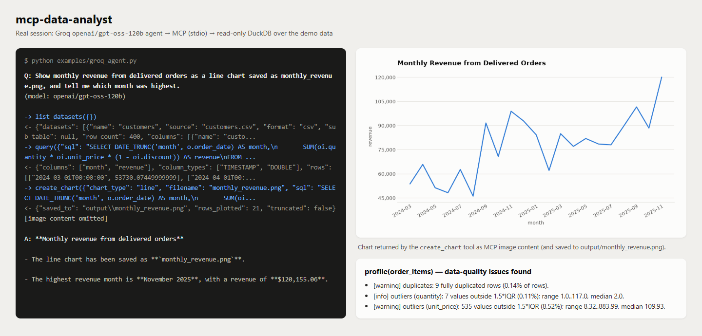
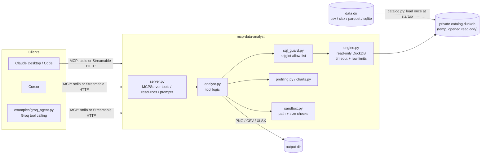

# mcp-data-analyst

[](https://github.com/MuhammadAhmadRajpoot/mcp-data-analyst/actions/workflows/ci.yml)
[](https://www.python.org/)
[](LICENSE)
[](https://github.com/modelcontextprotocol/python-sdk)

**A Model Context Protocol server that gives any MCP client (Claude Desktop, Claude Code, Cursor or your own
agent) safe, read-only data-analysis tools over local CSV, Excel, Parquet and SQLite files.** Point it at a folder
and the model can list the tables, inspect schemas, run DuckDB SQL, profile data quality, draw charts and export
results. It cannot modify your data, read files outside that folder, or run arbitrary statements: SQL is checked
with `sqlglot` before it runs, and the DuckDB connection is opened read-only with file-system access turned off,
so each layer blocks writes even if the other one is bypassed.



## Features

- **Six tools**: `list_datasets`, `describe_dataset`, `query`, `profile`, `create_chart`, `export_result`.
- **Four file formats**: CSV/TSV, Parquet, Excel (`.xlsx`, one table per sheet), SQLite (one table per table).
  Every file in the data directory (recursively) becomes a SQL table you can join with the others.
- **DuckDB SQL** with joins, CTEs, window functions and aggregates. Results come back as typed, structured JSON
  (`structuredContent` plus a matching `outputSchema`; `create_chart` returns text and image content instead).
- **Profiling**: summary statistics, histograms, top values, Pearson correlations, and data-quality checks for
  duplicate rows, missing values, IQR outliers, constant columns and columns that look like identifiers.
- **Charts**: bar, line, scatter and histogram charts drawn with matplotlib. Each chart is returned as MCP
  **image content**, so the model can see it, and is also saved as a PNG.
- **Resources**: `dataset://catalog` and the `dataset://{name}/schema` template.
- **Prompts**: `exploratory_analysis` and `data_quality_report`, which turn a dataset's schema into a
  step-by-step plan that uses the tools above.
- **Two transports**: stdio (for desktop clients) and Streamable HTTP (default port 8106).
- **Security**: a sandboxed data directory, a SQL allow-list, a read-only engine, row/time/size/memory limits, and
  errors returned to the client as normal tool errors. See [Security model](#security-model).
- **Demo client**: [`examples/groq_agent.py`](examples/groq_agent.py) is a small MCP *client* agent built on
  Groq tool calling. It shows the client side of the protocol.

## Architecture



At startup, `catalog.py` finds the supported files in the data directory and loads each one into a private,
temporary DuckDB catalog file. Excel and SQLite files are read with pandas, and SQLite files are opened in `mode=ro`.
The engine then reopens that catalog **read-only**, with `enable_external_access=false` and `lock_configuration=true`.
Every query goes through `sql_guard.py` first.

## Reference

### Tools

| Tool | Arguments | Returns |
|---|---|---|
| `list_datasets` | none | Every dataset: name, source file, format, sheet/table, row count, columns and types |
| `describe_dataset` | `name`, `sample_rows` (0-50, default 5) | Per-column type, null count and %, distinct count, plus sample rows |
| `query` | `sql`, `max_rows` (optional, capped by the server limit) | `columns`, `column_types`, `rows`, `row_count`, `truncated`, `elapsed_ms` |
| `profile` | `name`, `columns` (optional subset) | Numeric stats and histograms, top values, date ranges, top correlations, `duplicate_rows`, `issues[]` |
| `create_chart` | `sql`, `chart_type` (`bar`/`line`/`scatter`/`histogram`), `x`, `y`, `title`, `bins`, `filename` | Text summary and a PNG **image content** block; the file is saved to the output dir |
| `export_result` | `sql`, `format` (`csv`/`xlsx`), `filename` | Path, rows written, `truncated` flag |

`list_datasets`, `describe_dataset`, `query` and `profile` are annotated `readOnlyHint: true`. `create_chart` and
`export_result` are marked non-destructive: they only create files in the output directory.

### Resources

| URI | Content |
|---|---|
| `dataset://catalog` | JSON list of all datasets and their schemas |
| `dataset://{name}/schema` | JSON schema of one dataset (columns, types, row count, source) |

### Prompts

| Prompt | Arguments | Purpose |
|---|---|---|
| `exploratory_analysis` | `dataset`, `goal` (optional) | EDA plan: describe, profile, 3-5 targeted queries, charts, then a report backed by the numbers |
| `data_quality_report` | `dataset` | Audit: profile issues, example rows for each issue, referential-integrity checks, a table of fixes |

## Quickstart

Requires Python 3.12+.

```bash
git clone https://github.com/MuhammadAhmadRajpoot/mcp-data-analyst.git
cd mcp-data-analyst
python -m venv .venv
source .venv/bin/activate        # Windows: .venv\Scripts\activate
pip install -e ".[dev,examples]"

# stdio (what desktop clients launch)
mcp-data-analyst --data-dir data/demo --output-dir output

# Streamable HTTP on http://127.0.0.1:8106/mcp
mcp-data-analyst --transport streamable-http --port 8106 --data-dir data/demo --output-dir output
```

### Demo dataset

`data/demo` holds a small, fully **synthetic** e-commerce dataset (about 250 KB). It is generated from a fixed seed
by [`scripts/generate_demo_data.py`](scripts/generate_demo_data.py) and uses every supported format:

| Table | File | Rows |
|---|---|---|
| `customers` | `customers.csv` | 400 |
| `orders` | `orders.parquet` | 2,500 |
| `order_items` | `order_items.csv` | 6,279 |
| `products` | `products.xlsx` | 48 |
| `support_tickets` | `support.sqlite` (table `tickets`) | 600 |

The generator adds some data-quality problems on purpose so that `profile` has something real to find:
14 missing emails, 9 duplicated order lines, 6 extreme quantities and 75 missing satisfaction scores.

### Configuration

Each setting can be passed as a CLI flag or an environment variable. A flag overrides the variable.

| Flag | Env var | Default |
|---|---|---|
| `--data-dir` | `MCP_DA_DATA_DIR` | `data/demo` |
| `--output-dir` | `MCP_DA_OUTPUT_DIR` | `output` |
| `--transport` | `MCP_DA_TRANSPORT` | `stdio` (or `streamable-http`) |
| `--host` / `--port` | `MCP_DA_HOST` / `MCP_DA_PORT` | `127.0.0.1` / `8106` |
| `--max-rows` | `MCP_DA_MAX_ROWS` | `500` rows per `query` |
| `--max-export-rows` | `MCP_DA_MAX_EXPORT_ROWS` | `100000` |
| `--query-timeout-s` | `MCP_DA_QUERY_TIMEOUT_S` | `10` seconds |
| `--max-file-size-mb` | `MCP_DA_MAX_FILE_SIZE_MB` | `100` (larger files are skipped) |
| `--memory-limit` | `MCP_DA_MEMORY_LIMIT` | `1GB` (DuckDB) |
| `--log-level` | `MCP_DA_LOG_LEVEL` | `INFO` (JSON lines on stderr) |

`MCP_DA_MAX_PROFILE_ROWS` (default 200,000) sets how many rows `profile` reads. Larger tables are
reservoir-sampled with a fixed seed.

## Client configuration

Use **absolute paths**. Desktop clients do not start the server in the repository folder. The examples below
assume the repo is at `/path/to/mcp-data-analyst`. On Windows the executable is
`C:\path\to\mcp-data-analyst\.venv\Scripts\mcp-data-analyst.exe` (in JSON, escape each backslash as `\\`).

**Claude Desktop** (`claude_desktop_config.json`):

```json
{
  "mcpServers": {
    "data-analyst": {
      "command": "/path/to/mcp-data-analyst/.venv/bin/mcp-data-analyst",
      "args": ["--data-dir", "/path/to/your/data", "--output-dir", "/path/to/mcp-data-analyst/output"]
    }
  }
}
```

**Claude Code**:

```bash
# stdio
claude mcp add data-analyst -- /path/to/mcp-data-analyst/.venv/bin/mcp-data-analyst \
  --data-dir /path/to/your/data --output-dir /path/to/mcp-data-analyst/output

# or connect to a running Streamable HTTP server
claude mcp add --transport http data-analyst http://127.0.0.1:8106/mcp
```

**Cursor** (`~/.cursor/mcp.json` or `.cursor/mcp.json` in a project):

```json
{
  "mcpServers": {
    "data-analyst": {
      "command": "/path/to/mcp-data-analyst/.venv/bin/mcp-data-analyst",
      "args": ["--data-dir", "/path/to/your/data", "--output-dir", "/path/to/mcp-data-analyst/output"]
    }
  }
}
```

To use a running HTTP server instead, replace `command`/`args` with `"url": "http://127.0.0.1:8106/mcp"`.

**Docker** (Streamable HTTP; mount your own data read-only):

```bash
docker build -t mcp-data-analyst .
docker run --rm -p 8106:8106 -v /path/to/your/data:/data:ro mcp-data-analyst
```

## Demo: a Groq agent as the MCP client

[`examples/groq_agent.py`](examples/groq_agent.py) starts the server as a subprocess over stdio and lists its
tools. It converts each MCP tool's JSON Schema into an OpenAI-style function definition, then runs a
tool-calling loop against Groq's OpenAI-compatible API. The model is configurable with `--model` or `GROQ_MODEL`.

```bash
cp .env.example .env    # add your GROQ_API_KEY
python examples/groq_agent.py "Show monthly revenue from delivered orders as a line chart saved as monthly_revenue.png, and tell me which month was highest."
```

Transcript of a real run with `openai/gpt-oss-120b`. It has been re-wrapped to fit the page, the long tool payloads
are cut off with `...`, and the answer's markdown is removed. The full output (with only the local path prefix removed) is in
[`docs/transcript.txt`](docs/transcript.txt):

```text
-> list_datasets({})
<- {"datasets": [{"name": "customers", "source": "customers.csv", "format": "csv", ...
-> query({"sql": "SELECT DATE_TRUNC('month', o.order_date) AS month,
       SUM(oi.quantity * oi.unit_price * (1 - oi.discount)) AS revenue
   FROM orders o JOIN order_items oi ON o.order_id = oi.order_id
   WHERE o.status = 'delivered' GROUP BY month ORDER BY month"})
<- {"columns": ["month", "revenue"], "column_types": ["TIMESTAMP", "DOUBLE"], "rows": [["2024-03-01T00:00:00", 53730.07...
-> create_chart({"chart_type": "line", "filename": "monthly_revenue.png", "sql": "SELECT DATE_TRUNC(...", "x": "month", "y": "revenue",
                 "title": "Monthly Revenue from Delivered Orders"})
<- {"saved_to": "output\\monthly_revenue.png", "rows_plotted": 21, "truncated": false}
[image content omitted]

A: - The line chart has been saved as monthly_revenue.png.
   - The highest revenue month is November 2025, with a revenue of $120,155.06.
```

Open-weight models sometimes produce a call to a tool that does not exist. Groq rejects these with
`tool_use_failed`, and the agent simply asks the model again (up to 3 attempts).

## Security model

The server assumes the model, and anyone who can influence its prompts, may be hostile.

| Threat | Mitigation |
|---|---|
| Writing or deleting data | The SQL guard allows only a single `SELECT`/set operation and rejects any `INSERT`, `UPDATE`, `DELETE`, `MERGE`, `CREATE`, `DROP`, `ALTER`, `COPY`, `ATTACH`, `DETACH`, `INSTALL`, `PRAGMA`, `SET`, `USE` or transaction node anywhere in the tree. Independently, the DuckDB catalog is opened `read_only=True`. |
| Stacked statements (`SELECT 1; DROP ...`) | sqlglot parses the whole input and anything other than exactly one statement is rejected. |
| Reading files outside the sandbox | Only registered dataset names (and CTE names) are valid table references. Quoted paths such as `FROM 'C:/secret.csv'`, qualified names, and file or system functions (`read_*`, `glob`, `sqlite_scan`, `getenv`, `duckdb_*`, ...) are rejected. The engine also runs with `enable_external_access=false`, so DuckDB itself refuses file I/O, `ATTACH` and extension installs. |
| Re-enabling features at runtime | `lock_configuration=true` makes every `SET` fail. |
| Path traversal and symlinks | When the catalog is built, a data file is only registered if its *resolved* path is still inside the data dir, so symlinks pointing outside are skipped. Output file names must be bare names (`[A-Za-z0-9_.-]`, no `..`, no separators) with an allowed extension, must resolve inside the output dir, and may not be existing symlinks. |
| Resource exhaustion | Row caps for `query` and exports, a per-query timeout (`interrupt()` on a timer), DuckDB `memory_limit`, a maximum file size when files are loaded, and sampling for `profile`. |
| Leaking internals | Expected failures are `ToolError` subclasses and reach the client as `isError` results with a clear message. Any unexpected exception is logged on the server, and the client only sees `Error executing tool <name>`. Logs go to stderr, never to stdout, which the stdio protocol uses. |

Both layers are tested on their own: `tests/test_security.py` sends DDL, `COPY`, `ATTACH`, `SET` and `read_csv`
straight to the engine *without* the guard and checks that DuckDB refuses each one.

Not in scope: authentication for the HTTP transport. It binds to `127.0.0.1` by default, and the SDK's
DNS-rebinding protection is active for localhost. If you expose it more widely, put it behind an authenticating
proxy.

## Running tests

```bash
python -m pytest                 # offline suite (integration test deselected by default)
python -m pytest -m integration  # real Groq + stdio round trip, needs GROQ_API_KEY
ruff check . && ruff format --check .
```

The offline suite calls every tool, resource and prompt through the SDK's in-memory client. It also covers the
legacy initialize-handshake transport and runs the real console entry point as a stdio subprocess. The security
tests cover the SQL guard (allowed and blocked queries), engine-level read-only enforcement, query timeouts, file
size limits, path traversal and symlinks. The two symlink tests are skipped on Windows machines that do not allow
creating symlinks.

Current result on Windows 11 / Python 3.13: **101 passed, 2 skipped** offline, and **1 passed** for the
integration test.

### Task commands

A `Makefile` wraps the common commands. Without `make`, run the command shown in the Makefile.

| `make ...` | Does |
|---|---|
| `install` | `pip install -e ".[dev,examples]"` |
| `lint` / `format` | ruff check + format |
| `test` / `test-integration` | offline suite / Groq integration test |
| `data` | regenerate `data/demo` |
| `serve` / `serve-http` | run over stdio / Streamable HTTP on port 8106 |
| `agent` | run the Groq demo agent |
| `docker` | build and run the container |

### Screenshot

`docs/screenshot.png` was made from the real agent run shown above. `scripts/render_screenshot.py` combines
`docs/transcript.txt`, the chart the agent created and a live `profile(order_items)` call into an HTML page.
That page was then captured with `npx -y playwright screenshot --channel msedge --viewport-size=1440,690 ...`.

## Project structure

```text
mcp-data-analyst/
├── src/mcp_data_analyst/
│   ├── cli.py             # argparse + env -> Settings, transport selection
│   ├── config.py          # pydantic-settings (MCP_DA_*)
│   ├── server.py          # MCPServer: tools, resources, prompts (thin async wrappers)
│   ├── analyst.py         # tool implementations, transport-agnostic
│   ├── catalog.py         # file discovery -> private DuckDB catalog
│   ├── engine.py          # read-only DuckDB, timeouts, row limits, JSON conversion
│   ├── sql_guard.py       # sqlglot validation
│   ├── sandbox.py         # data-dir discovery, safe output paths
│   ├── profiling.py       # stats, histograms, correlations, quality issues
│   ├── charts.py          # matplotlib (object API, headless)
│   ├── prompts.py         # prompt templates
│   ├── models.py          # pydantic result models (tool output schemas)
│   ├── errors.py          # ToolError subclasses
│   └── logging_config.py  # JSON logs to stderr
├── examples/groq_agent.py # MCP client + Groq tool calling
├── scripts/               # demo data generator, screenshot renderer
├── data/demo/             # synthetic dataset (csv, parquet, xlsx, sqlite)
├── tests/                 # pytest suite (in-memory MCP client, security, stdio)
├── docs/                  # screenshot + real transcript
├── Dockerfile, Makefile, pyproject.toml, .github/workflows/ci.yml
```

## Roadmap

- Pick up new or changed files without a restart (a `refresh` tool or a file watcher with `resources/list_changed`).
- Optional lazy views instead of loading every file at startup, for large Parquet folders.
- More chart types (grouped/stacked bars, box plots) and a series/colour column.
- Authentication options for the HTTP transport (the SDK's OAuth support).
- Row-level filters or column masking for sensitive columns.

## License

[MIT](LICENSE) © 2026 Muhammad Ahmad

## Author

**Muhammad Ahmad**, AI/ML Engineer

- Portfolio: <https://muhammad-ahmad-rajpoot.vercel.app/>
- LinkedIn: <https://www.linkedin.com/in/muhammad-ahmad-a31b04322/>
- GitHub: [@MuhammadAhmadRajpoot](https://github.com/MuhammadAhmadRajpoot)
